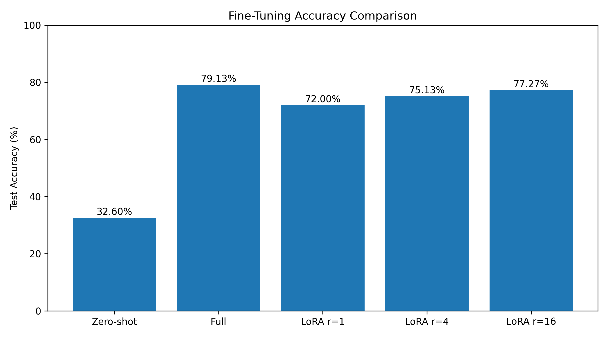
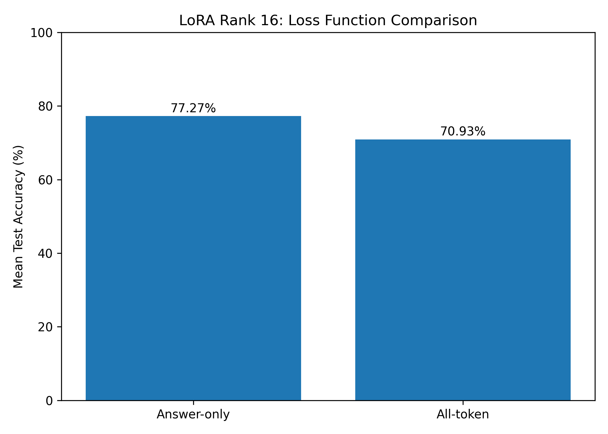
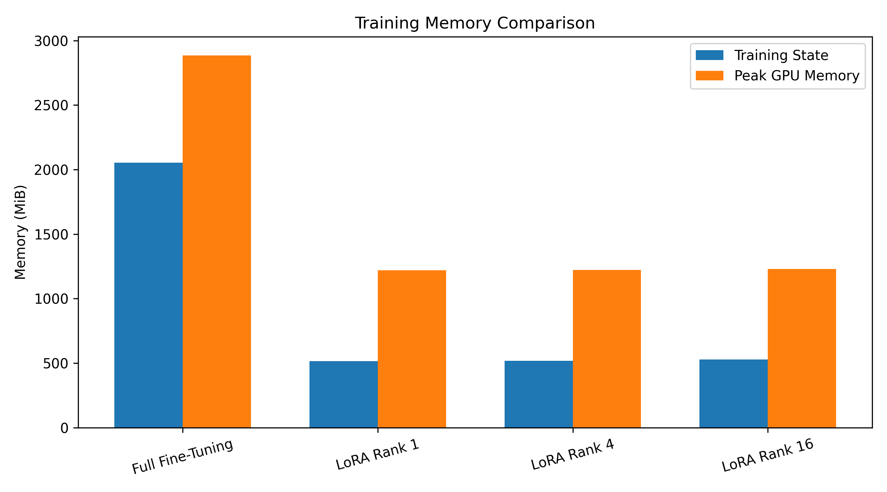

# Fine-Tuning a Language Model with LoRA

**Comparing Full Fine-Tuning and Parameter-Efficient Fine-Tuning for Emotion Classification**

Python | PyTorch | Hugging Face Transformers | PEFT | Google Colab

## Overview

The goal of the current project is the fine-tuning of a small language model via LoRA and the comparison of its performance with that of conventional fine-tuning.

The pretrained **SmolLM2-135M** language model and the **Emotion dataset** by Hugging Face were used. The task was the emotion classification based on the input text (six classes).

The objective was not limited to the training of a model and the estimation of its performance metrics but included also the investigation of how different ranks impact the performance of LoRA, the number of trained parameters, and GPU memory savings.

A custom LoRA linear layer was developed and validated against the PEFT library, and different ranks were tested (1, 4, 16). Additionally, an answer-only loss and an all-token loss were compared.

The experiments were conducted in Google Colab using PyTorch.

## Project Setup

| Component | Configuration |
|---|---|
| Base model | `HuggingFaceTB/SmolLM2-135M` |
| Dataset | `dair-ai/emotion` |
| Task | Text emotion classification |
| Number of classes | 6 |
| Training samples | 600 |
| Test samples | 500 |
| Training steps | 120 |
| Batch size | 8 |
| Random seeds | 0, 1, 2 |
| Full fine-tuning learning rate | 5e-5 |
| LoRA learning rate | 1e-3 |

Consistency was maintained in the dataset, number of training steps, and batch sizes. However, there was variation in the learning rates due to full fine-tuning and LoRA in accordance with the experiment conditions.

## What I Implemented

### 1. Answer-Only Loss

Firstly, this consisted of defining an appropriate loss function for classification.

As the model is given a prompt and produces an emotion label, taking the loss for the whole prompt does not make sense from a classification perspective.

For this reason, I introduced `answer_only_labels()` which will allow masking all parts of the prompt and the padding parts with `-100`, leaving just the answer token.

In addition, I made sure that there was one answer token per example using assertions.

This would allow comparing the loss for just the answer tokens with the original loss for all tokens in further experiments.

### 2. Custom LoRA Layer

I coded the `LoRALinear` class in PyTorch to gain insight into how LoRA is working underneath the hood and not simply utilizing the library provided.

LoRA freezes the pretrained weight matrix and learns an update via two low-rank matrices.

The calculation is:

`W_updated = W + (alpha / r) * (B @ A)`

Where:

- `W` is the original pretrained weight matrix.
- `A` and `B` are the trainable low-rank matrices.
- `r` is the LoRA rank.
- `alpha` controls the scaling of the update.

I assigned matrix A small random values and matrix B zeroes, thereby making the LoRA layer function in the same way as the original linear layer.

For testing my code, I performed the following tests: I checked the initial output, the number of trainable parameters, the output from the merged weights, and the correctness of the PEFT code with the same adapter weights.

All the tests have been successfully passed.

### 3. LoRA Rank Prediction

In advance of the main experiment, I wrote down the following prediction in the repository:

> I predict that LoRA with rank 16 will have accuracy close to that of full fine-tuning since it has more trainable parameters and can learn a more complex low-rank update.
>
> I predict that LoRA with rank 1 will perform worse than LoRA with rank 16 and possibly full fine-tuning since it cannot learn more complex changes because of its low rank.
>
> Nonetheless, this is only a prediction, and the true results may differ from them. I will conduct analysis of all three seeds first.

This prediction was added to the repository on GitHub before the main experiment.

## Experiments and Results

Full fine-tuning and LoRA tests were performed with three random seeds per setting.

Answer-only loss was the basis of the primary test. Then, I performed all-token loss test on LoRA rank 16.

All in all, I completed **15 training experiments**, including zero-shot test of the pretrained model.

### Model Accuracy

| Method | Seed 0 | Seed 1 | Seed 2 | Mean Accuracy |
|---|---:|---:|---:|---:|
| Full Fine-Tuning | 79.00% | 78.80% | 79.60% | **79.13%** |
| LoRA Rank 1 | 72.20% | 71.60% | 72.20% | 72.00% |
| LoRA Rank 4 | 76.40% | 74.40% | 74.60% | 75.13% |
| LoRA Rank 16 | 77.00% | 76.40% | 78.40% | **77.27%** |
| LoRA Rank 16 (All-Token) | 71.60% | 70.20% | 71.00% | 70.93% |

The pretrained model achieved **32.60% zero-shot accuracy** before fine-tuning.



### Comparing Full Fine-Tuning and LoRA

Fully fine-tuned models yielded the highest mean accuracy of 79.13%.

In the LoRA settings, model rank 16 yielded the best performance with a mean accuracy of 77.27%. This was just **1.87 percentage points less** than fully fine-tuned models.

An interesting result from the experiment was the number of trainable parameters.

| Method | Trainable Parameters | Percentage of Total Parameters |
|---|---:|---:|
| Full Fine-Tuning | 134,515,008 | 100% |
| LoRA Rank 1 | 57,600 | 0.0428% |
| LoRA Rank 4 | 230,400 | 0.1710% |
| LoRA Rank 16 | 921,600 | 0.6805% |

With LoRA rank 16, it was possible for me to obtain accuracy nearly equal to that of full fine-tuning using only **99.31% fewer parameters**.

My predictions came true as well. The accuracy increased with an increase in LoRA rank, but the increment in accuracy became small with the increase in rank.

This specific task required the use of rank 16 to obtain the highest accuracy.

### Answer-Only vs All-Token Loss

I was interested to see if the loss function will matter when training the same LoRA model.

For this experiment, I stuck with rank 16 and the rest of the training parameters while switching the loss function from answer only to all tokens.

| Loss Function | Mean Accuracy |
|---|---:|
| Answer-Only | **77.27%** |
| All-Token | 70.93% |



The answer-only loss performed **6.33% better on average**.

It means that the attention on the task of predicting the emotion labels is more effective than also training the model to generate the prompt tokens.

Such a comparison has shown that the choice of the training task is important regardless of the architecture of the model and the number of its parameters.

## Memory and Training Efficiency

Memory comparison between theoretical values and those observed during training was another aspect of the project.

Memory was estimated based on FP32 model parameters, gradients, and optimizer state.

The formula used was:

`Training State Memory = 4 × Total Parameters + 12 × Trainable Parameters`

This includes:

- 4 bytes per model parameter for weights.
- 4 bytes per trainable parameter for gradients.
- 8 bytes per trainable parameter for Adam optimizer states.

### Memory Comparison

| Method | Predicted State (MiB) | Measured State (MiB) | Peak GPU (MiB) |
|---|---:|---:|---:|
| Full Fine-Tuning | 2052.54 | 2052.54 | 2885.92 |
| LoRA Rank 1 | 514.01 | 514.01 | 1219.27 |
| LoRA Rank 4 | 516.65 | 516.65 | 1221.37 |
| LoRA Rank 16 | 527.20 | 527.20 | 1230.15 |



For all the four combinations, the training-state memory predictions were the same as the actual training-state memory values.

The peak GPU memory requirement was larger since the estimation did not consider the activations, temporary tensors, and other memories consumed during training.

As compared to fine-tuning, LoRA with a rank 16 used:

- About **74.3%** less training-state memory.
- About **57.4%** less peak GPU memory.

The pre-trained network would still have to reside in the memory, even if its parameters are frozen. The primary savings of LoRA come from the lesser gradients and optimizer states.

### Training Time

| Method | Average Training Time |
|---|---:|
| Full Fine-Tuning | 20.52 seconds |
| LoRA Rank 1 | 16.34 seconds |
| LoRA Rank 4 | 15.86 seconds |
| LoRA Rank 16 | 16.16 seconds |
| LoRA Rank 16 (All-Token) | 15.90 seconds |

LoRA was quicker than full fine-tuning in this experiment, although the variances in LoRA ranks were relatively minor.

These times were taken from Google Colab and could depend on the hardware and runtime conditions.

## What the Results Show

Comparing the experiments revealed several interesting results.

**LoRA can achieve comparable accuracy using significantly fewer trainable parameters.** While full fine-tuning gave 79.13% mean accuracy on the test dataset, Rank 16 obtained 77.27%, updating less than 1% of the total number of model's parameters.

**Higher rank resulted in higher accuracy in this experiment.** Among different LoRA setups, rank 1 demonstrated the worst accuracy while Rank 16 worked the best. At the same time, higher ranks needed to have a larger number of trainable parameters.

**The loss function mattered.** Answer-only loss gave better results than all-token loss on the emotion classification task.

**Efficiency gains with respect to the parameter space also led to reductions in memory consumption.** LoRA reduced memory consumption for storing gradients and optimizer states, leading to significantly reduced peak GPU utilization.

This is true for the tested model and dataset but does not mean that the same LoRa rank is the best in general cases.

## Limitations

The training was done with 600 training samples, 500 testing samples, and a fixed budget of 120 training steps.

One pretrained model and three random seeds were used for each case. Trying larger data sizes, other models, and more training steps might give a clearer picture of the extent of generalizability of the findings.

Learning rate values also differed between full fine-tuning and LoRA, which makes the comparison valid for that specific case.

The project is concerned with classification performance and training efficiency rather than with testing the performance of the model in general language generation.

## Repository Structure

```text
LLM-Fine-Tuning-with-LoRA/
├── Lab06_Fine_Tune_with_LoRA.ipynb
├── lab06_starter.py
├── requirements.txt
├── README.md
├── .gitignore
└── artifacts/
    ├── accuracy_comparison.png
    ├── loss_comparison.png
    ├── memory_comparison.png
    ├── experiment_results.csv
    └── memory_results.csv
```

Implementation, verification tests, and experiments are done inside the notebook.

The file `lab06_starter.py` was given as part of the lab assignment and is attached separately.

The folder `artifacts` has saved measurement data and visualizations from experiments.

## Running the Project

Experiments have been performed in Google Colab with GPU support.

To reproduce the work:

1. Clone or download the repository.
2. Open `Lab06_Fine_Tune_with_LoRA.ipynb` in Google Colab.
3. Enable a GPU runtime.
4. Install the required libraries.
5. Keep `lab06_starter.py` in the notebook's working directory.
6. Run the notebook cells in order.

Package versions as captured using `pip freeze` in the Colab environment have been placed in the file `requirements.txt`. Some of the dependencies especially those with CUDA version will need modifications in other environments.

Results of all the 15 runs have been recorded in `artifacts/experiment_results.csv`.

## Conclusion

The experiment provided an opportunity to apply LoRA method in practice, compare it with the known library, and analyze the trade-off between accuracy and training efficiency.

Complete fine-tuning resulted in the best accuracy, while LoRA rank 16 yielded almost the same accuracy score with notably fewer parameters for training and lower GPU memory consumption.

It was also discovered that the selection of loss function influences the quality of classification, with answer-only loss outperforming the others.

The presented experiments illustrate how efficient fine-tuning with parameter efficiency is applicable when using pretrained language models with the limitation on computational power.
